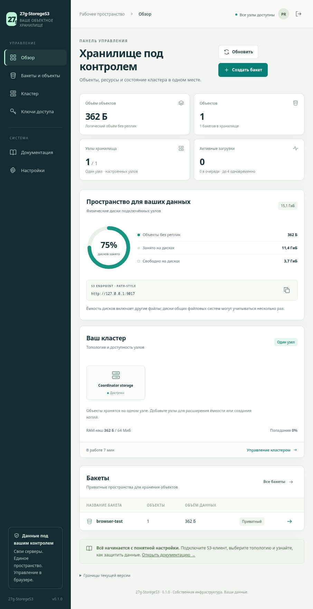
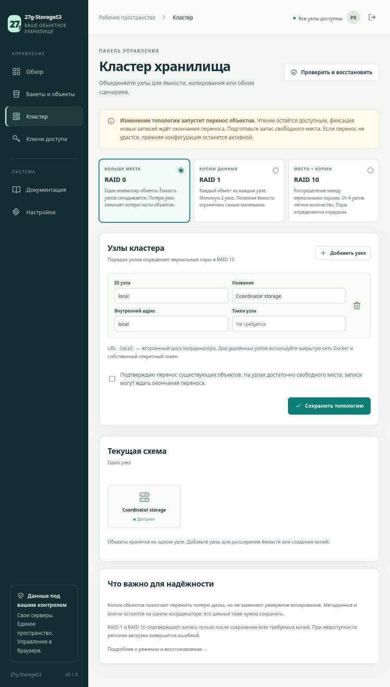
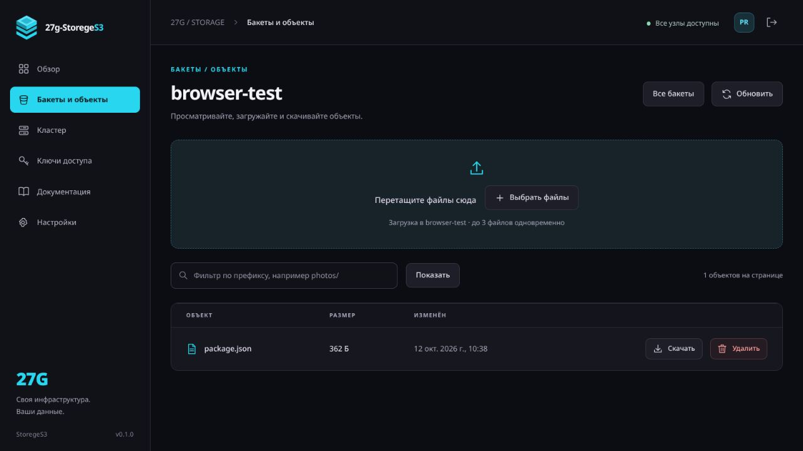
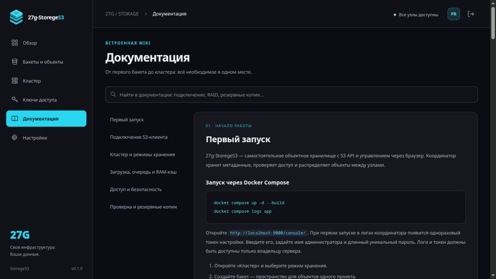

# 27g-StoregeS3

Собственное объектное хранилище с S3 API, веб-панелью на русском и отдельными узлами хранения. Управление бакетами, объектами, ключами, кластером, переносом данных, проверкой реплик и настройками — через браузер.

**Веб-панель на русском · S3 Signature V4 · RAID0 / RAID1 / RAID10 · Docker · Без npm-зависимостей**

**Статус: рабочая экспериментальная версия 0.1.0.** Это основа для дальнейшей разработки, не проверенная замена MinIO для критичных данных. Реализован ограниченный набор S3 API. Координатор и его метаданные пока не имеют автоматической отказоустойчивости. Независимый аудит, длительные испытания отказов и замеры производительности ещё не проводились.

## Как выглядит

Графитовая панель с циановым акцентом `#28D7EF` оформлена в стиле семейства 27G: боковое меню, крупные показатели и спокойные карточки для работы с данными. Основа оформления и выбранная палитра описаны в [дизайне проекта](docs/DESIGN.md).

Снимки настоящей веб-панели на локальном тестовом экземпляре. На них один узел и один тестовый объект; показания диска относятся к тестовой среде и не являются результатами нагрузочных испытаний. Порт `9017` использовался для снимков; обычный запуск использует `9000`.



<details>
<summary><strong>Настройка кластера: RAID0, RAID1, RAID10 и перенос объектов</strong></summary>



</details>

<details>
<summary><strong>Объекты: загрузка через браузер, поиск и скачивание</strong></summary>



</details>

<details>
<summary><strong>Встроенная Wiki с поиском</strong></summary>



</details>

## Возможности

| Область | Что доступно |
|---|---|
| Веб-панель | Бакеты, файлы, drag-and-drop, очередь с прогрессом, временные ссылки с отзывом, управление ключами и узлами, настройки ресурсов, журнал действий, Wiki |
| S3 API | Базовые операции с бакетами и объектами, AWS SigV4, presigned URL, проверка checksum, списки с пагинацией, Range GET |
| Кластер | Распределение объектов, зеркалирование и зеркальные пары; добавление/удаление узлов с переносом данных |
| Сохранность | Подтверждение после записи требуемых копий на диск; проверка SHA-256, чтение исправной копии, восстановление реплик |
| Ресурсы | Потоковые загрузки, ограниченные очереди, настраиваемый LRU-кэш небольших объектов |
| Доступ | Отдельные S3-ключи с правами чтения/записи и ограничением бакетов; защищённые сессии администратора |
| Развёртывание | Docker Compose для одного сервера, четырёх тестовых узлов, отдельного удалённого узла и HTTPS-прокси |

## Навигация

- [Быстрый запуск](#быстрый-запуск)
- [Кластер из четырёх контейнеров](#кластер-из-четырёх-контейнеров) и [узлы на разных серверах](#узлы-на-разных-серверах)
- [Режимы хранения](#режимы-хранения) и [перенос данных](#добавление-узлов-и-перенос)
- [Совместимость S3 и примеры клиентов](docs/S3-COMPATIBILITY.md)
- [Сравнение S3-хранилищ и приоритеты развития](docs/FEATURE-ROADMAP.md)
- [HTTPS](#https), [защита](#защита) и [резервное копирование](#резервное-копирование-и-восстановление)
- [Продолжение разработки на другом устройстве](#продолжение-разработки-на-другом-устройстве)

## Быстрый запуск

Нужны Linux, Docker Engine и Docker Compose. Сервис не требует npm install, внешней БД или Redis.

```sh
git clone git@github.com:gadmin2151/27G-StorageS3.git
cd 27G-StorageS3
docker compose up -d --build
docker compose logs app
```

Откройте **http://localhost:9000/console/**. На новой установке администратор создаётся автоматически:

- **Логин:** `admin`
- **Начальный пароль:** `admin!123`

В Docker и при сетевом запуске форма дополнительно запросит `Initial setup token` из `docker compose logs app`. Токен также хранится в `/data/setup.token` внутри контейнера. Пока используется начальный пароль, токен требуется при каждом сетевом входе: общедоступной пары логин/пароль недостаточно для доступа к серверу. При прямом запуске Node только на loopback, без `PUBLIC_ORIGIN` и доверенных прокси, достаточно логина и пароля.

В «Настройках» можно заменить начальный пароль уникальным паролем от 12 символов; после этого токен для входа не нужен. **Перезапуск и обновление не сбрасывают изменённые данные входа.** Существующие установки сохраняют своих администраторов. Данные по умолчанию создаются только при пустой таблице пользователей. Не публикуйте начальный токен и закройте доступ к журналам сервера.

По умолчанию порт опубликован только на `127.0.0.1`. Для удалённой первичной настройки можно использовать SSH:

```sh
ssh -L 9000:127.0.0.1:9000 user@your-server
```

В панели:

1. Создайте бакет в разделе «Бакеты».
2. Загрузите файлы через выбор файлов или drag-and-drop. Очередь показывает прогресс и ошибки.
3. В разделе «Ключи доступа» создайте ключ для приложения. Секрет показывается только при создании.
4. Укажите в S3-клиенте endpoint `http://localhost:9000`, регион `us-east-1`, режим адресации **path-style**.

В интерфейс встроена Wiki с поиском. Точная совместимость и примеры клиентов: [S3-COMPATIBILITY.md](docs/S3-COMPATIBILITY.md).

## Как поделиться фото или файлом

В разделе **«Бакеты и объекты»** откройте бакет и нажмите **«Поделиться»** в строке файла перед кнопкой «Скачать». Укажите **дни и часы** (от 1 часа до 7 дней), нажмите **«Сгенерировать ссылку»**, затем **«Скопировать ссылку»**. По умолчанию выбран один час.

Получателю достаточно открыть ссылку: аккаунт, пароль, отдельный токен или S3-ключ не нужны. Каждый, кто получил адрес, может прочитать этот файл до указанного времени. Адрес показывается при создании; после закрытия окна можно сгенерировать новый. В том же окне видны активные ссылки и кнопка **«Отозвать»**. Срок и отзыв сохраняются после перезапуска. Перезапись или удаление файла прекращают действие его старых ссылок. Уже начавшееся скачивание может завершиться; скачанную копию отозвать нельзя.

JPEG, PNG, GIF, WebP и AVIF с соответствующим Content-Type открываются прямо в браузере. Другие типы, включая HTML, SVG и PDF, скачиваются. Бакет остаётся приватным; ссылка разрешает чтение только конкретного файла.

Ссылка на `127.0.0.1` или `localhost` работает только на том же компьютере. Для других устройств нужен доступный им адрес сервера. Для интернета настройте [HTTPS](#https) и `PUBLIC_ORIGIN`: новые ссылки будут содержать этот внешний адрес. Обращайтесь с действующей ссылкой как с временным доступом к файлу; не публикуйте её случайно в журнале или Git.

## Кластер из четырёх контейнеров

```sh
./scripts/init-cluster.sh
docker compose --profile cluster up -d --build
cat secrets/node_token
```

Скрипт создаёт случайный секрет; существующий секрет не меняется. В разделе «Кластер» добавьте узлы `node1`–`node4` с адресами `http://node1:9100` … `http://node4:9100` и токеном из файла. Сохраните выбранный режим. Для четырёхузлового RAID10 удалите локальный узел из выбранного состава, чтобы осталось ровно четыре узла.

Четыре контейнера на одном сервере удобны для проверки работы. **Они не дают защиты от отказа этого сервера или его общего диска.** Для реальной независимости размещайте копии на разных серверах и физических накопителях.

## Узлы на разных серверах

На каждом сервере скопируйте проект, выполните `./scripts/init-cluster.sh`, затем:

```sh
NODE_BIND_IP=10.10.0.11 docker compose -f compose.node.yaml up -d --build
```

Замените адрес на частный/VPN-адрес этого сервера. В веб-панели координатора добавьте `http://10.10.0.11:9100` и секрет именно этого узла. Межузловой HTTP предназначен для доверенной изолированной сети или VPN; для недоверенной сети нужен TLS-прокси. Порт узла 9100 не публикуйте в Интернет. Docker, сеть и физические диски первоначально подготавливаются на серверах; дальнейшее управление хранилищем выполняется в веб-панели.

Каждому узлу нужен собственный volume. Не запускайте несколько координаторов с одним каталогом данных. Не монтируйте один каталог blobs одновременно нескольким узлам. Используйте локальную Linux-файловую систему с надёжными fsync/atomic rename; NFS и другие сетевые ФС не проверялись.

## Режимы хранения

Это аналоги RAID **на уровне целых объектов**, а не поблочное чередование одного большого файла. Размещение определяется rendezvous hashing; размер объектов и различия ёмкости узлов не учитываются при выборе целевого узла.

| Режим | Узлы | Размещение | Ёмкость и отказ |
|---|---|---|---|
| RAID0 | От 1 | Одна копия объекта на выбранном узле | Для одинаковых дисков суммарная ёмкость; отказ узла делает его объекты недоступными. Остальные объекты остаются доступны. |
| RAID1 | От 2 | Каждый объект на каждом выбранном узле | Ёмкость самого маленького узла; чтение возможно при наличии одной исправной копии. |
| RAID10 | От 4, чётное число | Пары 1–2, 3–4 и далее; объект хранится на обоих узлах выбранной пары | Для одинаковых дисков примерно половина общей ёмкости; можно потерять по одному узлу в разных парах, но не оба узла пары с данными. |

При любом режиме **запись подтверждается только после fsync всех требуемых копий и фиксации каталога SQLite**. В RAID1 недоступность любого выбранного узла блокирует новые записи; в RAID10 — недоступность одного из узлов целевой пары. Автоматической записи в деградированное зеркало нет. Неудачная перезапись сохраняет предыдущую версию объекта. Чтение использует исправную копию, проверенную по SHA-256.

Ёмкость не складывается линейно для разнородных дисков или неравномерных размеров объектов. Показания дисков в панели — данные ФС узлов; несколько volumes на одном диске сообщают одну и ту же физическую ёмкость, их нельзя суммировать как независимые диски. Копия на другом узле не заменяет резервную копию: удаление объекта также удаляет его из общего каталога.

## Добавление узлов и перенос

В разделе «Кластер» отредактируйте узлы и режим. Если данные уже есть, подтвердите перенос. Система проверяет доступность нового состава, копирует и проверяет все нужные реплики, затем одной транзакцией фиксирует размещение и новую топологию.

До успешного завершения действует старый каталог. При сбое копирования топология не меняется. Записи ожидают завершения переноса; чтения продолжают работать. Не выключайте старые узлы до завершения. Перенос требует дополнительного свободного места, может занять длительное время и пока не умеет продолжаться с места остановки после перезапуска. Увеличьте таймаут внешнего прокси для больших переносов; результат проверяйте через страницу кластера.

## Очереди, память и синхронизация

- Тела загрузок читаются потоком во временные файлы, а не целиком в RAM. По умолчанию допускаются 4 активные загрузки и 32 ожидающие; переполненная очередь возвращает `503 SlowDown`.
- Репликация одного объекта идёт параллельно по узлам. Фиксация записей, миграция и восстановление упорядочены общим mutex; это упрощает целостность, но ограничивает масштабирование записи первой версии.
- LRU-кэш по умолчанию 64 MiB, кэшируются объекты до 1 MiB, не более 4096 записей. Кэш содержит только подтверждённые данные и не является источником долговечности. Размер кэша и параллелизм изменяются из панели.
- Полная проверка реплик и восстановление из исправной копии выполняются автоматически каждые 15 минут и вручную кнопкой в панели. Интервал меняется в настройках, `0` отключает автоматическую проверку. Проверка временно задерживает фиксацию новых записей.
- Старые/неудачные копии удаляются сборщиком мусора после часового защитного периода во время проверки реплик. Поэтому освобождение диска после удаления объекта происходит не сразу. При отключённой автопроверке запускайте проверку вручную.
- Каждый некэшированный GET проверяет целый объект до выдачи. Удалённая копия сначала загружается во временный файл координатора. Это защищает от выдачи повреждённой копии, но увеличивает задержку первого байта, трафик и требования к временной ёмкости. Range также требует проверки целого объекта.

Прикладной лимит — 5 GiB на один PUT. Межузловые запросы имеют ограниченные таймауты (30 секунд чтение, 120 секунд запись), поэтому фактический допустимый размер зависит от скорости сети и дисков. Для больших объектов нужны будущие multipart и настраиваемые таймауты. Внешние балансировщики и браузер также могут оборвать длительную операцию; проверяйте состояние перед повтором.

## HTTPS

Создайте `.env` на основе `.env.example`, добавьте:

```dotenv
DOMAIN=s3.example.com
PUBLIC_ORIGIN=https://s3.example.com
```

Настройте DNS на сервер и запустите:

```sh
docker compose -f compose.yaml -f compose.https.yaml up -d --build
```

Caddy получает сертификат и обслуживает S3 и `/console/` по HTTPS. Админ-панель следует ограничить VPN или allowlist на прокси, если публичный доступ нужен только S3. Конфигурация включает `Secure` cookies и HSTS; сначала убедитесь, что HTTPS действительно работает.

HTTPS compose использует отдельную сеть `172.29.27.0/29`, Caddy `.2` и приложение `.3`; если она конфликтует с вашей инфраструктурой, согласованно измените подсеть, адреса и `TRUSTED_PROXY_IPS`. Приложение принимает клиентский IP из перезаписываемого Caddy заголовка только от явно доверенного адреса. Не разрешайте доверять произвольным прокси.

## Защита

Есть scrypt для пароля, случайные сессии с ограниченным сроком, HttpOnly/SameSite cookies, CSRF и проверка Origin, ограничение попыток входа, AWS SigV4 с проверкой времени и тела запроса, scoped read-only/read-write ключи, экранирование вывода, CSP и загрузка пользовательских объектов как attachment. Секреты S3-ключей зашифрованы AES-256-GCM ключом `master.key` в том же защищённом volume. Это не защищает от полного захвата сервера или утечки всего volume.

Межузловые токены хранятся в защищённом каталоге метаданных. Файлы объектов не шифруются приложением на диске. Для шифрования носителя используйте возможности ОС/дисков. Контейнеры работают без root, с read-only rootfs и без Linux capabilities. Протокол узлов доверяет авторизованному координатору.

Эти меры снижают риск; гарантии «невозможно взломать» нет. Для публичной эксплуатации ещё нужны независимый аудит, тесты устойчивости к перегрузке, мониторинг, проверка обновлений образов и резервные копии. MFA/OIDC, полноценный IAM, квоты, audit всех S3-запросов и KMS пока не реализованы. Журнал панели фиксирует административные изменения; это не неизменяемый журнал аудита.

## Резервное копирование и восстановление

Для согласованного снимка остановите приложение и узлы. Сохраните **целиком все volumes**, а также `.env` и `secrets/`. Каталог координатора включает `catalog.sqlite` с его WAL/SHM, `auth.sqlite` и `shares.sqlite` с WAL/SHM, `master.key`, `setup.token`, blobs и временные данные. Копии одних blobs недостаточно: без каталога теряются имена объектов и их размещение; без master.key не расшифровать ключи доступа.

После восстановления всех volumes и секретов запустите сервисы и выполните проверку реплик из панели. Не копируйте только файл SQLite из работающей системы; остановите сервисы либо используйте согласованный механизм backup SQLite/снимков. `docker compose down` сохраняет volumes, а **`docker compose down -v` уничтожает данные**.

После штатного завершения файл `coordinator.lock` удаляется. После аварии Linux process start identity позволяет безопасно обнаружить устаревший PID при обычном перезапуске одного экземпляра. Несколько хостов/контейнеров с общим volume не поддерживаются. Если lock повреждён, сначала убедитесь, что старый координатор остановлен, и только затем удаляйте его вручную.

## Разработка и проверки

Нужны Linux и Node.js 22.13+ со встроенным `node:sqlite` (экспериментальный API в Node 22). Внешних npm-зависимостей нет.

```sh
node src/server.mjs
node --test tests/*.test.mjs
docker compose config --quiet
```

Тесты создают временные каталоги и реальные HTTP-узлы на loopback. Проверяются AWS-образец подписи, S3-жизненный цикл, права и CSRF, проверки checksum, перезапуск, очередь, сбой зеркала, повреждение копии, RAID10, миграция/откат и очистка старых копий. Это функциональные тесты; они не доказывают сохранность при всех вариантах сбоя питания, split-brain или отказа накопителя.

## Дальнейшая разработка

Подробный [отчёт о MinIO и других S3-хранилищах](docs/FEATURE-ROADMAP.md) содержит предложения по функциям, зависимостям и критериям готовности. Это план развития, а не список уже реализованных возможностей.

1. Реплицированный каталог с quorum/consensus, fencing и автоматическим failover координатора; тесты разделения сети.
2. S3 multipart, streaming signatures/checksum trailers, метаданные, versioning, политики и совместимость с реальными SDK/клиентами в CI.
3. Потоковые подтверждённые чтения по чанкам, фоновая возобновляемая миграция и восстановление, планирование ёмкости, квоты.
4. Управление сертификатами и join-токенами из панели, MFA/OIDC, метрики/алерты, backup/restore wizard.
5. Нагрузочные испытания, fault injection, независимый аудит и образы с зафиксированными проверенными digest.

## Продолжение разработки на другом устройстве

В репозитории хранится переносимый контекст проекта:

- [AGENTS.md](AGENTS.md) — правила работы и отправная точка для помощника по коду.
- [docs/PROJECT_MEMORY.md](docs/PROJECT_MEMORY.md) — требования, принятые решения, устройство проекта, выполненные проверки, ограничения и очередные задачи.
- [docs/S3-COMPATIBILITY.md](docs/S3-COMPATIBILITY.md) — точный контракт API и примеры интеграции.
- [docs/FEATURE-ROADMAP.md](docs/FEATURE-ROADMAP.md) — исследование других S3-систем и предложения по развитию; реализация требует отдельной задачи.

Клонируйте репозиторий на другом устройстве, откройте каталог в редакторе или Codex и дайте задачу:

> Прочитай AGENTS.md и docs/PROJECT_MEMORY.md. Продолжи разработку 27g-StoregeS3 с учётом текущих ограничений и результатов проверок.

Перед сменой устройства сохраняйте изменения коммитом и отправляйте свою ветку в GitHub; на другом устройстве получайте её через `git pull --ff-only`, если рабочее дерево чистое. Не заменяйте локальные незакоммиченные изменения. После значимых изменений обновляйте файл состояния проекта.

Это документация проекта, доступная на любом устройстве после клонирования. История чата, настройки аккаунта, приватные сессии и секреты не переносятся через Git. Данные хранилища и Docker volumes также не входят в репозиторий — для них используйте отдельное резервное копирование.
