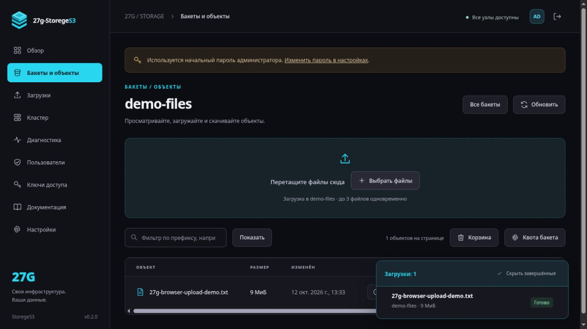
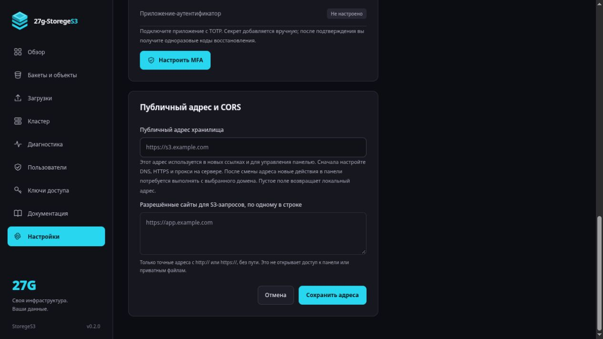

# 27G-StorageS3

Собственное объектное хранилище с S3 API, веб-панелью на русском и отдельными узлами хранения. Управление бакетами, объектами, ключами, кластером, переносом данных, проверкой реплик и настройками — через браузер.

**Веб-панель на русском · S3 Signature V4 · RAID0 / RAID1 / RAID10 · Docker · Без npm-зависимостей**

**Статус: экспериментальная версия 0.3.1.** Добавлены установка и обновление одной командой с диалоговым мастером, а также сборка релизов в GitHub Actions. Есть подключение дискового агента одной командой, предпросмотр объектов и политика чтения по прямому пути без выдачи списка файлов. Сохраняются multipart, последние пять версий, корзина, пользователи/MFA/квоты, мониторинг и отдельный режим HA master/slave с арбитром etcd. Это ограниченный S3 API, не проверенная замена MinIO для критичных данных. HA использует полные снимки метаданных и пока не освобождает старые blobs физически; его ограничения описаны в [HA.md](docs/HA.md). Независимый аудит, длительные испытания отказов и замеры производительности ещё не проводились.

## Как выглядит

Графитовая панель с циановым акцентом `#28D7EF` оформлена в стиле семейства 27G: боковое меню, крупные показатели и спокойные карточки для работы с данными. Основа оформления и выбранная палитра описаны в [дизайне проекта](docs/DESIGN.md).

Снимки настоящей панели с демонстрационными данными, без ключей и токенов. Объекты и предпросмотр сняты в версии **0.3** на локальном экземпляре `9022`. Обзор и адрес сервиса ниже относятся к версии **0.2** (`9021`), кластер и Wiki — к этапу дизайна **0.1**. Показания диска относятся к тестовой среде и не являются результатами нагрузочных испытаний. Обычный запуск использует порт `9000`.


<details>
<summary><strong>Предпросмотр изображения внутри панели — версия 0.3</strong></summary>


</details>

<details>
<summary><strong>Обзор: объекты, диски и RAM-кэш — версия 0.2</strong></summary>


</details>

<details>
<summary><strong>Настройка кластера: RAID0, RAID1, RAID10 и перенос объектов — версия 0.1</strong></summary>


</details>

<details>
<summary><strong>Загрузка через браузер, поиск и скачивание — версия 0.2</strong></summary>



</details>

<details>
<summary><strong>Встроенная Wiki с поиском — версия 0.1</strong></summary>


</details>

<details>
<summary><strong>Публичный домен и CORS в настройках — версия 0.2</strong></summary>



</details>

## Возможности

| Область | Что доступно |
|---|---|
| Веб-панель | Бакеты, файлы и предпросмотр, drag-and-drop, очередь с прогрессом, временные ссылки с отзывом, управление ключами и узлами, настройки ресурсов, журнал с пагинацией, Wiki |
| S3 API | Бакеты и объекты, AWS SigV4, presigned URL, multipart/resume, ограниченные версии, checksum, списки с пагинацией, Range GET |
| Кластер | Распределение объектов, зеркалирование и зеркальные пары; добавление/удаление узлов с переносом данных |
| Сохранность | Последние 5 версий, корзина и восстановление; подтверждение после сохранения обязательных копий, SHA-256 и ремонт реплик |
| Ресурсы | Потоковые загрузки, ограниченные очереди, настраиваемый LRU-кэш небольших объектов |
| Доступ | Пользователи admin/operator/viewer, MFA, квоты; S3-ключи с операциями, префиксами и сроком; закрытые бакеты либо анонимное чтение разрешённых путей без списка файлов |
| Мониторинг | Запросы, ошибки, задержки p50/p95/p99, память, очереди, предупреждения о дисках/узлах; защищённый экспорт Prometheus |
| Диски | Подключение агента одной командой из панели; каталоги, /dev с ext4/XFS/Btrfs, SMB 3 и NFSv4; мастер подключения без форматирования |
| Адрес сервиса | Публичный домен и отдельный список CORS в настройках; временные ссылки используют сохранённый адрес |
| Развёртывание | Установщик с диалогами; GitHub Actions, релизы и образы GHCR; Compose для одиночного сервера, узлов, HTTPS, master/slave с etcd и дискового агента |

## Навигация

- [Быстрый запуск](#быстрый-запуск)
- [Установка, параметры и обновление](docs/INSTALLATION.md), [CI/CD и выпуск версии](docs/CI-CD.md)
- [Кластер из четырёх контейнеров](#кластер-из-четырёх-контейнеров) и [узлы на разных серверах](#узлы-на-разных-серверах)
- [Режимы хранения](#режимы-хранения) и [перенос данных](#добавление-узлов-и-перенос)
- [Совместимость S3 и примеры клиентов](docs/S3-COMPATIBILITY.md)
- [HA master/slave](docs/HA.md), [подключение дисков, SMB/CIFS и NFS](docs/DISKS.md)
- [Новое в версии 0.3](#новое-в-версии-03) и [возможности версии 0.2](#возможности-версии-02)
- [Сравнение S3-хранилищ и приоритеты развития](docs/FEATURE-ROADMAP.md)
- [HTTPS](#https), [защита](#защита) и [резервное копирование](#резервное-копирование-и-восстановление)
- [Продолжение разработки на другом устройстве](#продолжение-разработки-на-другом-устройстве)

## Быстрый запуск

На Linux выполните в терминале:

```sh
curl -fsSL https://github.com/gadmin2151/27G-StorageS3/releases/latest/download/install.sh | bash
```

Мастер предложит каталог установки, порт, сетевой интерфейс и необязательный публичный адрес сервиса. Диалоги работают и при запуске через pipe: ввод читается из терминала. Если установлен `whiptail`, откроются окна; иначе будут обычные текстовые вопросы. Нужны `curl`, `python3`, `sha256sum`, Docker Engine с Compose 2.20+ и root либо `sudo`. При отсутствии Docker мастер может предложить его установку на Debian/Ubuntu с отдельным подтверждением.

На новом сервере по умолчанию создаётся одиночный экземпляр в `/opt/27g-storage-s3` с доступом **http://127.0.0.1:9000/console/**. Установщик загружает конкретный релиз и проверяет SHA-256 архива; использует готовый образ либо предлагает собрать его на сервере. В конце показывает команды управления и получения начального токена. Повторный запуск предлагает совместимое обновление образа: тот же volume сохраняется, файлы и базы не копируются. Установка дискового агента выполняется отдельно из раздела «Кластер». [Все параметры, установка без вопросов и обновление](docs/INSTALLATION.md).

### Запуск из исходников

Для разработки или собственной Compose-конфигурации нужны Git, Docker Engine и Docker Compose. Сервис не требует npm install, внешней БД или Redis.

```sh
git clone git@github.com:gadmin2151/27G-StorageS3.git
cd 27G-StorageS3
docker compose up -d --build
docker compose logs app
```

Откройте **http://localhost:9000/console/**. На новой установке администратор создаётся автоматически:

- **Логин:** `admin`
- **Начальный пароль:** `admin!123`

В Docker и при сетевом запуске форма дополнительно запросит `Initial setup token` из `docker compose logs app` (из исходников) или `sudo docker compose -f /opt/27g-storage-s3/compose.yaml logs app` (после установки скриптом). Токен также хранится в `/data/setup.token` внутри контейнера. Пока используется начальный пароль, токен требуется при каждом сетевом входе: общедоступной пары логин/пароль недостаточно для доступа к серверу. При прямом запуске Node только на loopback, без `PUBLIC_ORIGIN` и доверенных прокси, достаточно логина и пароля.

В «Настройках» можно заменить начальный пароль уникальным паролем от 12 символов; после этого токен для входа не нужен. **Перезапуск и обновление не сбрасывают изменённые данные входа.** Существующие установки сохраняют своих администраторов. Данные по умолчанию создаются только при пустой таблице пользователей. Не публикуйте начальный токен и закройте доступ к журналам сервера.

По умолчанию порт опубликован только на `127.0.0.1`. Для удалённой первичной настройки можно использовать SSH:

```sh
ssh -L 9000:127.0.0.1:9000 user@your-server
```

В панели:

1. Создайте бакет в разделе «Бакеты».
2. Загрузите файлы через выбор файлов или drag-and-drop. Очередь показывает прогресс и ошибки.
3. В разделе «Ключи доступа» создайте ключ для приложения. Секрет показывается только при создании.
4. Укажите в S3-клиенте endpoint `http://localhost:9000`, регион `us-east-1`, режим адресации **path-style**.

В интерфейс встроена Wiki с поиском. Точная совместимость и примеры клиентов: [S3-COMPATIBILITY.md](docs/S3-COMPATIBILITY.md).

## Как поделиться фото или файлом

В разделе **«Бакеты и объекты»** откройте бакет и нажмите значок **«Поделиться»** в строке файла. Команда также доступна в меню действий файла. Укажите **дни и часы** (от 1 часа до 7 дней), нажмите **«Сгенерировать ссылку»**, затем **«Скопировать ссылку»**. По умолчанию выбран один час.

Получателю достаточно открыть ссылку: аккаунт, пароль, отдельный токен или S3-ключ не нужны. Каждый, кто получил адрес, может прочитать этот файл до указанного времени. Адрес показывается при создании; после закрытия окна можно сгенерировать новый. В том же окне видны активные ссылки и кнопка **«Отозвать»**. Срок и отзыв сохраняются после перезапуска. Перезапись или удаление файла прекращают действие его старых ссылок. Уже начавшееся скачивание может завершиться; скачанную копию отозвать нельзя.

JPEG, PNG, GIF, WebP и AVIF с соответствующим Content-Type открываются прямо в браузере. Другие типы, включая HTML, SVG и PDF, скачиваются. Создание временной ссылки не меняет политику бакета: закрытый бакет остаётся закрытым, а ссылка разрешает чтение конкретного файла. Если администратор отдельно включил открытое чтение, для разрешённых путей действует и постоянный адрес.

Ссылка на `127.0.0.1` или `localhost` работает только на том же компьютере. Для других устройств нужен доступный им адрес сервера. Для интернета настройте [HTTPS](#https) и `PUBLIC_ORIGIN`: новые ссылки будут содержать этот внешний адрес. Обращайтесь с действующей ссылкой как с временным доступом к файлу; не публикуйте её случайно в журнале или Git.

## Кластер из четырёх контейнеров

```sh
./scripts/init-cluster.sh
docker compose --profile cluster up -d --build
cat secrets/node_token
```

Скрипт создаёт случайный секрет; существующий секрет не меняется. В разделе «Кластер» добавьте узлы `node1`–`node4` с адресами `http://node1:9100` … `http://node4:9100` и токеном из файла. Сохраните выбранный режим. Для четырёхузлового RAID10 удалите локальный узел из выбранного состава, чтобы осталось ровно четыре узла.

Четыре контейнера на одном сервере удобны для проверки работы. **Они не дают защиты от отказа этого сервера или его общего диска.** Для реальной независимости размещайте копии на разных серверах и физических накопителях.

## Узлы на разных серверах

На каждом сервере скопируйте проект, выполните `./scripts/init-cluster.sh`, затем:

```sh
NODE_BIND_IP=10.10.0.11 docker compose -f compose.node.yaml up -d --build
```

Замените адрес на частный/VPN-адрес этого сервера. В веб-панели координатора добавьте `http://10.10.0.11:9100` и секрет именно этого узла. Межузловой HTTP предназначен для доверенной изолированной сети или VPN; для недоверенной сети нужен TLS-прокси. Порт узла 9100 не публикуйте в Интернет. Docker, сеть и физические диски первоначально подготавливаются на серверах; дальнейшее управление хранилищем выполняется в веб-панели.

Каждому узлу нужен собственный volume. Не запускайте несколько координаторов с одним каталогом данных. Не монтируйте один каталог blobs одновременно нескольким узлам. Используйте локальную Linux-файловую систему с надёжными fsync/atomic rename; NFS и другие сетевые ФС не проверялись.

## Режимы хранения

Это аналоги RAID **на уровне целых объектов**, а не поблочное чередование одного большого файла. Размещение определяется rendezvous hashing; размер объектов и различия ёмкости узлов не учитываются при выборе целевого узла.

| Режим | Узлы | Размещение | Ёмкость и отказ |
|---|---|---|---|
| RAID0 | От 1 | Одна копия объекта на выбранном узле | Для одинаковых дисков суммарная ёмкость; отказ узла делает его объекты недоступными. Остальные объекты остаются доступны. |
| RAID1 | От 2 | Каждый объект на каждом выбранном узле | Ёмкость самого маленького узла; чтение возможно при наличии одной исправной копии. |
| RAID10 | От 4, чётное число | Пары 1–2, 3–4 и далее; объект хранится на обоих узлах выбранной пары | Для одинаковых дисков примерно половина общей ёмкости; можно потерять по одному узлу в разных парах, но не оба узла пары с данными. |

При любом режиме **запись подтверждается после fsync всех требуемых копий и фиксации метаданных**. В одиночном режиме это SQLite; в HA ответ дополнительно ждёт подтверждённой транзакции etcd. В RAID1 недоступность любого выбранного узла блокирует новые записи; в RAID10 — недоступность одного из узлов целевой пары. Автоматической записи в деградированное зеркало нет. Неудачная перезапись сохраняет предыдущую версию объекта. Чтение использует исправную копию, проверенную по SHA-256.

Ёмкость не складывается линейно для разнородных дисков или неравномерных размеров объектов. Показания дисков в панели — данные ФС узлов; несколько volumes на одном диске сообщают одну и ту же физическую ёмкость, их нельзя суммировать как независимые диски. Копия на другом узле не заменяет резервную копию. Корзина и версии находятся в той же системе; очистка корзины и выход за предел пяти версий удаляют соответствующие записи.

## Добавление узлов и перенос

В разделе «Кластер» отредактируйте узлы и режим. Если данные уже есть, подтвердите перенос. Система проверяет доступность нового состава, копирует и проверяет все нужные реплики, затем одной транзакцией фиксирует размещение и новую топологию.

До успешного завершения действует старый каталог. При сбое копирования топология не меняется. В одиночном режиме записи ожидают завершения переноса, чтения продолжают работать. В первой реализации HA общий guard упорядочивает также чтения: длительный перенос может задерживать запросы. Не выключайте старые узлы до завершения. Перенос требует дополнительного свободного места, может занять длительное время и пока не умеет продолжаться с места остановки после перезапуска. Увеличьте таймаут внешнего прокси для больших переносов; результат проверяйте через страницу кластера.

## Очереди, память и синхронизация

- Тела загрузок читаются потоком во временные файлы, а не целиком в RAM. По умолчанию допускаются 4 активные загрузки и 32 ожидающие; переполненная очередь возвращает `503 SlowDown`.
- Репликация одного объекта идёт параллельно по узлам. Фиксация записей, миграция и восстановление упорядочены общим mutex; это упрощает целостность, но ограничивает масштабирование записи первой версии.
- LRU-кэш по умолчанию 64 MiB, кэшируются объекты до 1 MiB, не более 4096 записей. Кэш содержит только подтверждённые данные и не является источником долговечности. Размер кэша и параллелизм изменяются из панели.
- Полная проверка реплик и восстановление из исправной копии выполняются автоматически каждые 15 минут и вручную кнопкой в панели. Интервал меняется в настройках, `0` отключает автоматическую проверку. Проверка временно задерживает фиксацию новых записей.
- В одиночном режиме старые/неудачные копии удаляются сборщиком мусора после часового защитного периода во время проверки реплик. Поэтому освобождение диска после удаления объекта происходит не сразу. При отключённой автопроверке запускайте проверку вручную. В HA физическая очистка пока отключена.
- Каждый некэшированный GET проверяет целый объект до выдачи. Удалённая копия сначала загружается во временный файл координатора. Это защищает от выдачи повреждённой копии, но увеличивает задержку первого байта, трафик и требования к временной ёмкости. Range также требует проверки целого объекта.

Прикладной лимит — 5 GiB на объект, включая суммарный размер multipart. Панель загружает файл частями по 8 MiB и позволяет продолжить передачу. Межузловые запросы имеют ограниченные таймауты (30 секунд чтение, 120 секунд запись), поэтому фактический допустимый размер зависит от скорости сети и дисков. Завершение multipart собирает и реплицирует весь объект; эта операция тоже зависит от таймаутов. Внешние балансировщики и браузер могут оборвать длительную операцию; проверяйте состояние перед повтором.

## HTTPS

Создайте `.env` на основе `.env.example`, добавьте:

```dotenv
DOMAIN=s3.example.com
PUBLIC_ORIGIN=https://s3.example.com
```

Настройте DNS на сервер и запустите:

```sh
docker compose -f compose.yaml -f compose.https.yaml up -d --build
```

Caddy получает сертификат и обслуживает S3 и `/console/` по HTTPS. Админ-панель следует ограничить VPN или allowlist на прокси, если публичный доступ нужен только S3. Конфигурация включает `Secure` cookies и HSTS; сначала убедитесь, что HTTPS действительно работает.

HTTPS compose использует отдельную сеть `172.29.27.0/29`, Caddy `.2` и приложение `.3`; если она конфликтует с вашей инфраструктурой, согласованно измените подсеть, адреса и `TRUSTED_PROXY_IPS`. Приложение принимает клиентский IP из перезаписываемого Caddy заголовка только от явно доверенного адреса. Не разрешайте доверять произвольным прокси.

## Защита

Есть scrypt для пароля, случайные сессии с ограниченным сроком, HttpOnly/SameSite cookies, CSRF и проверка Origin, ограничение попыток входа, AWS SigV4 с проверкой времени и тела запроса, scoped read-only/read-write ключи, экранирование вывода, CSP и скачивание пользовательских объектов как attachment. Предпросмотр отдельно разрешает проверенные растровые форматы; HTML, SVG и другой текст показываются как текст, без исполнения. Секреты S3-ключей зашифрованы AES-256-GCM ключом `master.key` в том же защищённом volume. Это не защищает от полного захвата сервера или утечки всего volume.

Межузловые токены хранятся в защищённом каталоге метаданных. Файлы объектов не шифруются приложением на диске. Для шифрования носителя используйте возможности ОС/дисков. Контейнеры основного приложения работают без root, с read-only rootfs и без Linux capabilities. Необязательный disk-agent в режиме каталогов не получает mount-capabilities; режим дисков/SMB/NFS требует отдельных привилегий. Агент подключают по частной сети/VPN либо через HTTPS-прокси. Протокол узлов доверяет авторизованному координатору.

Эти меры снижают риск; гарантии «невозможно взломать» нет. Для публичной эксплуатации ещё нужны независимый аудит, тесты устойчивости к перегрузке, внешние оповещения, проверка обновлений образов и резервные копии. TOTP MFA, роли и квоты доступны. OIDC, полноценный IAM, audit всех S3-запросов и KMS пока не реализованы. Журнал панели фиксирует административные изменения; это не неизменяемый журнал аудита.

## Резервное копирование и восстановление

Для согласованного снимка остановите приложение и узлы. Сохраните **целиком все volumes**, а также `.env` и `secrets/`. Каталог координатора включает `catalog.sqlite` с его WAL/SHM, `auth.sqlite` и `shares.sqlite` с WAL/SHM, `master.key`, `setup.token`, blobs и временные данные. Копии одних blobs недостаточно: без каталога теряются имена объектов и их размещение; без master.key не расшифровать ключи доступа.

Для HA дополнительно нужен согласованный backup etcd и общих секретов по [инструкции HA](docs/HA.md); SQLite-проекция одного координатора не заменяет авторитетное состояние кворума. Перед обновлением с 0.1 сохраните полную остановленную копию: миграция добавляет версии и столбец поколения доступа, запуск старой версии поверх обновлённого каталога не поддерживается. Откат выполняется восстановлением копии.

После восстановления всех volumes и секретов запустите сервисы и выполните проверку реплик из панели. Не копируйте только файл SQLite из работающей системы; остановите сервисы либо используйте согласованный механизм backup SQLite/снимков. `docker compose down` сохраняет volumes, а **`docker compose down -v` уничтожает данные**.

После штатного завершения файл `coordinator.lock` удаляется. После аварии Linux process start identity позволяет безопасно обнаружить устаревший PID при обычном перезапуске одного экземпляра. Несколько хостов/контейнеров с общим volume не поддерживаются. Если lock повреждён, сначала убедитесь, что старый координатор остановлен, и только затем удаляйте его вручную.

## Разработка и проверки

Нужны Linux и Node.js 22.13+ со встроенным `node:sqlite` (экспериментальный API в Node 22). Внешних npm-зависимостей нет.

```sh
node src/server.mjs
node --test tests/*.test.mjs
docker compose config --quiet
```

Для версии 0.3.1 локально прошли **122/122 теста без пропусков**, включая испытания с настоящими процессами etcd. Для повторения HA-тестов укажите `ETCD_BINARY=/путь/к/etcd` перед командой `node --test tests/*.test.mjs`; без бинарного файла часть проверок HA пропускается. Прежний результат 105/105 относится к этапу 0.3.0.

В [GitHub Actions, запуск 38246804120](https://github.com/gadmin2151/27G-StorageS3/actions/runs/38246804120) для коммита `eddebc9` прошли проверки `validate` (40 секунд), настоящий запуск координатора и дискового агента с перезапуском (4 секунды), установка и обновление через скрипт с настоящим Docker (32 секунды), публикация обоих образов для amd64/arm64 (2 минуты 22 секунды). При обновлении сохранились тот же volume, SHA-256 объекта, пароль и настройки. Был создан только первоначальный volume; несовместимая версия отклонена до остановки сервера. Стабильный релиз выпускается отдельно после этих проверок через **Actions → CI and release → Run workflow → publish_release** из `master`.

Локальный Docker Engine в среде разработки недоступен; приведённые проверки контейнеров выполнены на GitHub runner. Реальное подключение SMB/NFS/физических устройств и исполнение на ARM-сервере ещё не проверены. [Устройство CI/CD и выпуск версии](docs/CI-CD.md).

Тесты создают временные каталоги и реальные HTTP-узлы на loopback. Проверяются AWS-образец подписи, S3-жизненный цикл, права и CSRF, проверки checksum, перезапуск, очередь, сбой зеркала, повреждение копии, RAID10, миграция/откат и очистка старых копий. Это функциональные тесты; они не доказывают сохранность при всех вариантах сбоя питания, split-brain или отказа накопителя.

## Новое в версии 0.3

- **В 0.3.1 — установка и выпуск.** Диалоговый `install.sh` из GitHub Releases, параметры для установки без вопросов, сборки контейнеров `amd64`/`arm64` в GHCR, контрольные суммы релизных архивов. Обычный push в `master` публикует образ `edge`, тег версии — релиз. Работающие серверы автоматически не обновляются.
- **Агент одной командой.** В разделе «Кластер» нажмите «Подключить сервер», создайте команду и выполните её на нужном Linux-сервере с установленным Docker. Код действует 15 минут; после проверки связи агент появляется в панели автоматически. По умолчанию доступны папки, а привилегии для дисков/SMB/NFS включаются отдельно. Установщик проверяет SHA-256 перед выполнением, не форматирует диски и не устанавливает Docker. Для другого компьютера адрес координатора должен быть доступен по сети: `127.0.0.1` не подходит. Подробности и повтор после сетевой ошибки — в [инструкции агента](docs/DISKS.md).
- **Предпросмотр.** Нажмите имя файла либо выберите предпросмотр в его действиях или истории. Растровые PNG, JPEG, GIF, WebP и AVIF доступны до 20 МиБ при распознаваемом содержимом. Для текстовых UTF-8 файлов до 1 МиБ показываются первые 256 КиБ, с отметкой об обрезке. HTML и SVG отображаются только исходным текстом; PDF, неподдерживаемые и более крупные файлы можно скачать. Предпросмотр требует входа в панель.
- **Доступ к бакету.** Кнопка «Доступ» позволяет администратору выбрать закрытый режим (`private`) или открытое чтение (`public-read`), при необходимости только для префиксов вроде `photos/`. Существующие и новые бакеты по умолчанию закрыты. В открытом режиме разрешены только чтение/метаданные текущего файла по полному пути; анонимные списки, версии и запись запрещены. В действиях файла можно получить постоянную ссылку. Угаданный путь тоже позволит прочитать открытый файл, поэтому для личных данных используйте закрытый режим, S3-ключи или временные ссылки. Это ограниченная политика приложения, не полный язык AWS bucket policy/IAM.
- **Журнал.** В настройках записи показываются страницами по 10, 25 или 50; по умолчанию — 10. Есть переходы между страницами.
- **Оформление.** Используется выбранный циановый знак-куб, единые размеры кнопок и компактные действия файлов. Редкие действия вынесены в меню; кнопки со значками имеют подписи для подсказок и средств доступности.

## Возможности версии 0.2

- **Загрузки:** браузер отправляет части по 8 MiB. Раздел «Загрузки» показывает незавершённые операции; для продолжения после закрытия страницы повторно выберите тот же файл. Сохранённые части проверяются по SHA-256. Общий предел объекта пока остаётся 5 GiB, как и для одиночного PUT. Неиспользуемую загрузку можно отменить.
- **Пять версий:** сохраняются текущая и четыре предыдущие версии содержимого. Существовавшие до обновления файлы становятся первой версией. Удаление создаёт маркер и помещает файл в корзину; восстановление создаёт новую текущую версию. Маркер удаления не занимает одно из пяти мест. Старейшее содержимое сверх лимита удаляется из истории автоматически. Это ограниченная политика хранения, а не неограниченное версионирование Amazon S3.
- **Корзина:** файл остаётся до явной очистки или восстановления. Перед окончательной очисткой панель запрашивает подтверждение. Бакет с версиями, корзиной или незавершёнными загрузками не считается пустым. В HA физическое освобождение места пока отключено, хотя записи истории и квоты изменяются.
- **Доступ:** администратор управляет системой; оператор работает с файлами и своими S3-ключами; наблюдатель читает данные. Роли панели действуют на всё хранилище, это не изоляция арендаторов по бакетам. Ограничения бакетов/префиксов применяются к S3-ключам. MFA настраивается в личных настройках, коды восстановления показываются один раз.
- **Квоты:** лимит байтов и числа хранимых версий/активных загрузок можно задать пользователю и бакету. Учитываются содержимое сохранённых версий, части multipart и резерв активной передачи. Физические реплики и отложенный мусор показывают иной расход диска. Прежние данные без владельца учитываются в квоте бакета, но не назначаются произвольному новому пользователю.
- **Мониторинг:** раздел показывает состояние узлов, заполнение, очередь, статистику запросов и пороги предупреждений. История наблюдений и подтверждение предупреждений хранятся в памяти текущего процесса; после перезапуска/переключения начинаются заново. Внешняя отправка уведомлений пока не реализована. `/api/metrics` требует сессию администратора.
- **Кластер:** мастер рассчитывает примерную ёмкость и предупреждает о переносе, позволяет подключать/заменять узлы; операции используют существующую проверяемую миграцию. Продолжение самой миграции после перезапуска пока не реализовано. Для дисков нужен [дисковый агент](docs/DISKS.md), для переключения координатора — отдельная [HA-конфигурация](docs/HA.md).

### Публичный домен и CORS

В «Настройки → Адрес сервиса и CORS» сохраните, например, `https://s3.example.com`. При вводе одного доменного имени подставляется HTTPS. Новые временные ссылки, отображаемый S3 endpoint и адрес в ответе multipart используют его. Уже выданный текст ссылки у получателя автоматически не меняется; создайте новую ссылку или настройте перенаправление на прежнем домене.

До смены адреса направьте DNS на сервер и настройте HTTPS/reverse proxy. Сохранение поля не регистрирует домен и не выпускает сертификат. После смены используйте новый адрес панели: административные изменения проверяются относительно настроенного origin. Для исправления ошибочно сохранённого адреса администратор сервера может временно задать `PUBLIC_ORIGIN_OVERRIDE=http://127.0.0.1:9000` (либо правильный HTTPS origin), перезапустить, исправить поле, затем убрать override. При запуске через Compose явно передайте эту переменную сервису.

CORS задаётся **отдельно**, точными адресами сайтов, например `https://app.example.com`. Эти сайты получают разрешение браузера на S3-запросы. CORS сам по себе не открывает данные: закрытые объекты требуют подписи или presigned URL, а анонимное чтение возможно только там, где администратор отдельно включил `public-read`. CORS не разрешает доступ к административному API. Поддерживается глобальный список в настройках; S3 `PutBucketCors/GetBucketCors` пока не реализованы.

## Дальнейшая разработка

Подробный [отчёт о MinIO и других S3-хранилищах](docs/FEATURE-ROADMAP.md) содержит предложения по функциям, зависимостям и критериям готовности. Это план развития, а не список уже реализованных возможностей.

1. Развить HA: журнал изменений вместо полных снимков, fencing удаления на узлах, безопасная физическая очистка, доступный общий вход и длительные испытания отказов.
2. Streaming signatures/checksum trailers, пользовательские метаданные, CopyObject, lifecycle и расширенная проверка SDK/клиентов в CI.
3. Потоковые подтверждённые чтения по чанкам, фоновая возобновляемая миграция и восстановление, планирование ёмкости.
4. Управление сертификатами и обновлением агентов, OIDC, внешняя доставка предупреждений, backup/restore wizard.
5. Нагрузочные испытания, fault injection, независимый аудит и образы с зафиксированными проверенными digest.

## Продолжение разработки на другом устройстве

В репозитории хранится переносимый контекст проекта:

- [AGENTS.md](AGENTS.md) — правила работы и отправная точка для помощника по коду.
- [docs/PROJECT_MEMORY.md](docs/PROJECT_MEMORY.md) — требования, принятые решения, устройство проекта, выполненные проверки, ограничения и очередные задачи.
- [docs/S3-COMPATIBILITY.md](docs/S3-COMPATIBILITY.md) — точный контракт API и примеры интеграции.
- [docs/FEATURE-ROADMAP.md](docs/FEATURE-ROADMAP.md) — исследование других S3-систем и предложения по развитию; реализация требует отдельной задачи.

Клонируйте репозиторий на другом устройстве, откройте каталог в редакторе или Codex и дайте задачу:

> Прочитай AGENTS.md и docs/PROJECT_MEMORY.md. Продолжи разработку 27G-StorageS3 с учётом текущих ограничений и результатов проверок.

Перед сменой устройства сохраняйте изменения коммитом и отправляйте свою ветку в GitHub; на другом устройстве получайте её через `git pull --ff-only`, если рабочее дерево чистое. Не заменяйте локальные незакоммиченные изменения. После значимых изменений обновляйте файл состояния проекта.

Это документация проекта, доступная на любом устройстве после клонирования. История чата, настройки аккаунта, приватные сессии и секреты не переносятся через Git. Данные хранилища и Docker volumes также не входят в репозиторий — для них используйте отдельное резервное копирование.
