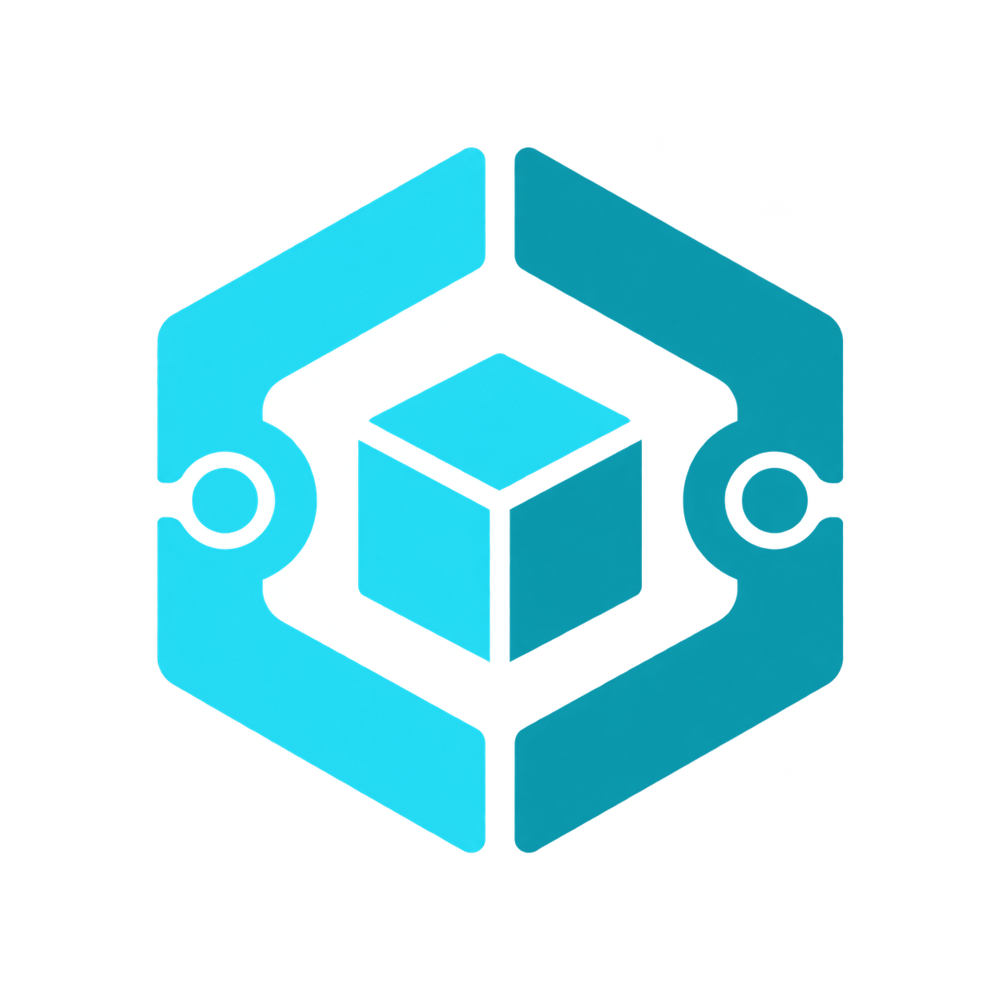
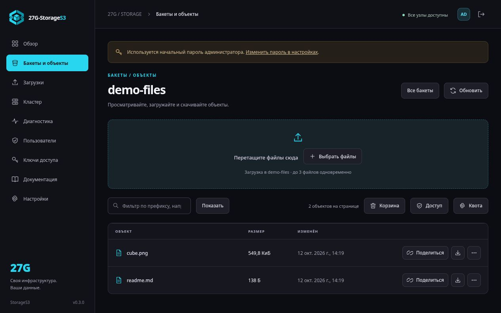
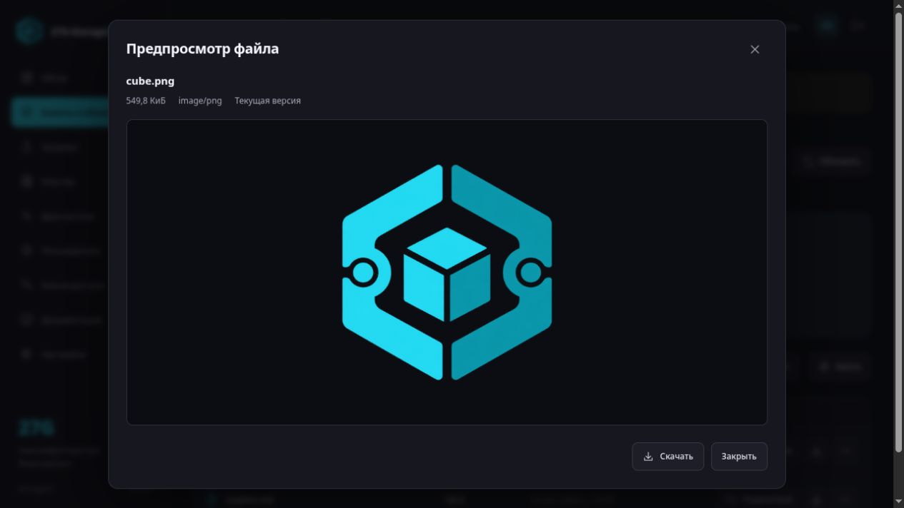
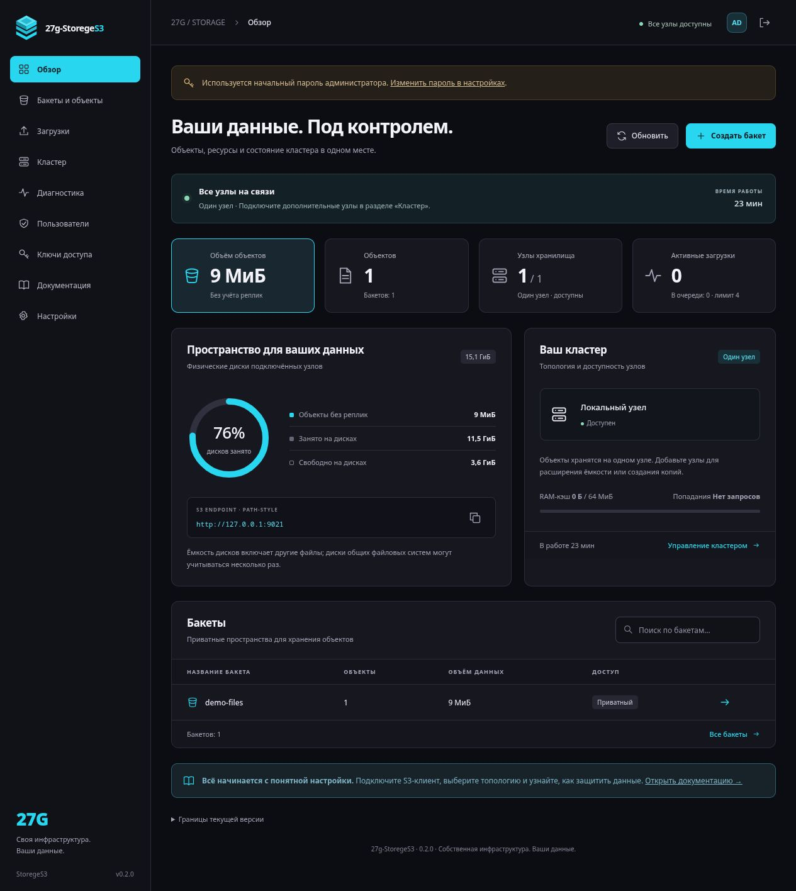

**[English](README.md) · Русский**

<p align="center">
  
</p>
<h1 align="center">27G-StorageS3</h1>
<p align="center"><strong>Ваши данные. Ваши серверы. Одна понятная панель.</strong></p>
<p align="center">Объектное хранилище с S3 API, веб-интерфейсом на английском и русском и объединением серверов в кластер.</p>
<p align="center">
  <a href="https://github.com/gadmin2151/27G-StorageS3/releases/latest"></a>
  <a href="https://github.com/gadmin2151/27G-StorageS3/actions/workflows/ci.yml"></a>
  <a href="docs/INSTALLATION.md"></a>
</p>
<p align="center">
  <a href="#быстрая-установка">Установить</a> ·
  <a href="#почему-27g-storages3">Преимущества</a> ·
  <a href="#сравнение-с-другими-хранилищами">Сравнение</a> ·
  <a href="#документация">Документация</a>
</p>

---

27G-StorageS3 объединяет повседневную работу с файлами и управление собственным хранилищем: загрузите фото, создайте временную ссылку, восстановите предыдущую версию или подключите новый сервер через одну веб-панель. Подходит для домашней лаборатории, разработки и пилотных развёртываний на своей инфраструктуре.

> **Статус: экспериментальная версия 0.3.2.** S3 API реализован частично. Перед использованием для критичных данных изучите [ограничения](#текущие-ограничения) и [матрицу совместимости](docs/S3-COMPATIBILITY.md).

Интерфейс по умолчанию на английском. После входа откройте **Settings → Language**, выберите **Русский** и сохраните. Язык хранится в вашей учётной записи и применяется при входе с другого устройства.

## Быстрая установка

**Linux amd64 / arm64 · Docker Engine + Compose 2.20+ · root или sudo**

Нужны `bash`, `curl`, `python3` и `sha256sum`. На Debian/Ubuntu мастер может предложить установку отсутствующего Docker. Node.js на сервер устанавливать не нужно.

```sh
curl -fsSL https://github.com/gadmin2151/27G-StorageS3/releases/latest/download/install-ru.sh | bash
```

Для английских диалогов используйте `install.sh` вместо `install-ru.sh`. Оба файла самостоятельные, поддерживают одинаковые параметры и обновление. Язык установщика не меняет язык панели.

Мастер спросит каталог, порт, сетевой интерфейс и публичный адрес. При наличии `whiptail` появятся диалоговые окна; иначе — текстовые вопросы. Архив релиза проверяется по SHA-256, готовые образы доступны в GHCR.

**1. Откройте панель:** [http://127.0.0.1:9000/console/](http://127.0.0.1:9000/console/) — адрес при настройках по умолчанию.

**2. Получите начальный токен** на сервере:

```sh
sudo docker compose -f /opt/27g-storage-s3/compose.yaml exec -T app cat /data/setup.token
```

**3. Войдите:** логин `admin`, пароль `admin!123` и полученный токен. В настройках задайте свой пароль от 12 символов, создайте бакет и загрузите первый файл. Если выбрали другой каталог установки, замените путь к `compose.yaml` в команде.

<details>
<summary><strong>Устанавливаете на удалённый сервер?</strong></summary>

По умолчанию порт доступен только на самом сервере. Откройте SSH-туннель со своего компьютера:

```sh
ssh -L 9000:127.0.0.1:9000 user@server
```

Затем перейдите по локальному адресу панели выше. Для публичного доступа настройте DNS, HTTPS и адрес сервиса по [инструкции](docs/OPERATIONS.md#https).

</details>

### Обновление той же командой

Повторите команду установки. Мастер обнаружит свою установку и предложит совместимое обновление: **сохраняется тот же Docker volume; объекты и базы не копируются**. Объём хранилища может составлять терабайты — установщик не делает его дубликат.

Контейнер кратковременно останавливается. Релиз с несовместимым контрактом хранения отклоняется до остановки; при неудачном запуске предусмотрен возврат к предыдущему образу. Это обновление одиночных установок, созданных мастером; ручные и HA-развёртывания обслуживаются отдельно. [Параметры и порядок обновления →](docs/INSTALLATION.md)

## Панель в работе

Графитовый интерфейс, циановый акцент и действия рядом с объектом: предпросмотр, история, ссылка и скачивание.



<details>
<summary><strong>Открыть скриншот предпросмотра изображения</strong></summary>



</details>

<details>
<summary><strong>Открыть скриншот обзора хранилища</strong></summary>



</details>

<sub>Настоящие снимки панели с демонстрационными данными: объекты и предпросмотр — v0.3, обзор — v0.2. Показания тестовой среды не являются результатами нагрузочных испытаний.</sub>

## Почему 27G-StorageS3

| Преимущество | Что это даёт на практике |
|:---|:---|
| **Веб-панель как основной инструмент** | Бакеты, файлы, S3-ключи, пользователи, кластер и настройки на русском. Встроенная Wiki помогает прямо в интерфейсе. |
| **Понятная установка и обновление** | Одна команда, диалоговый мастер, готовые Docker-образы. Совместимые обновления используют существующий том без копирования содержимого. |
| **Файлы удобно отдавать людям** | Предпросмотр изображений и текста, временные ссылки с выбором срока и отзывом. Получателю ссылки не нужна учётная запись. |
| **Восстановление повседневных ошибок** | Текущая и четыре предыдущие версии файла, корзина и восстановление из панели. Резервное копирование настраивается отдельно. |
| **Расширение на своих серверах** | Объектные RAID0 / RAID1 / RAID10, подключение агента одной командой, перенос данных и проверка реплик через мастер. |
| **Ресурсы и доступ под контролем** | Ограниченные очереди, потоковые загрузки, настраиваемый RAM-кэш, MFA, роли, квоты и мониторинг в одной системе. |

Для одиночного экземпляра не нужны внешний сервер БД или Redis: каталог хранится в SQLite. Приложение использует стандартные модули Node.js без внешних npm-зависимостей. Docker, сеть и подключение дисков подготавливаются на хостах; режим HA требует отдельного арбитра.

## Сравнение с другими хранилищами

Сильная сторона 27G-StorageS3 — повседневное администрирование собственного S3 через русскую панель. Сравнение ниже показывает, где это удобно; оно не является рейтингом производительности или надёжности.

| Система | Когда удобен подход 27G-StorageS3 |
|:---|:---|
| **MinIO Community** | Когда хочется управлять пользователями, доступом и хранилищем в одной русской панели. В upstream Community после упрощения Console операции Users / Policy / Config перенесены в `mc`. [Ответ команды MinIO](https://github.com/minio/minio/issues/21407). |
| **Garage** | Когда панель, предпросмотр файлов и Wiki нужны сразу в составе сервера. Garage документирует настройку через TOML и CLI; [Garage Web UI](https://github.com/khairul169/garage-webui) — отдельный проект. [Руководство Garage](https://garagehq.deuxfleurs.fr/documentation/quick-start/). |
| **Ceph Object Gateway** | Когда достаточно отдельного S3-сервера с последующим добавлением узлов. Одиночный 27G-StorageS3 использует приложение и SQLite; RGW работает поверх [Ceph Storage Cluster](https://docs.ceph.com/en/squid/radosgw/). У Ceph также есть [свой Dashboard](https://docs.ceph.com/en/squid/mgr/dashboard/). |
| **Amazon S3** | Когда данные должны находиться на собственных Linux-серверах и дисках, в том числе в локальной сети, без аккаунта AWS. [Amazon S3](https://docs.aws.amazon.com/AmazonS3/latest/userguide/Welcome.html) — управляемый сервис; [S3 on Outposts](https://docs.aws.amazon.com/AmazonS3/latest/s3-outposts/S3onOutposts.html) использует инфраструктуру AWS. |

<sub>Сведения об аналогах проверены 12 октября 2026 года. Строка MinIO относится к upstream Community, а не к AIStor или сторонним форкам. 27G-StorageS3 пока уступает зрелым системам по полноте API и объёму эксплуатационных испытаний.</sub>

## Что уже умеет система

| Область | Возможности |
|:---|:---|
| **S3 для приложений** | AWS Signature V4, path-style, presigned GET/PUT, multipart с продолжением загрузки, Range GET, checksum и пагинация. Объект до **5 GiB**, включая multipart. |
| **Файлы в браузере** | Drag-and-drop, прогресс и очередь, PNG/JPEG/GIF/WebP/AVIF и текст в предпросмотре, пять версий, корзина, временные ссылки на **1 час — 7 дней**. |
| **Политика бакетов** | Закрытый по умолчанию; можно разрешить публичное чтение по полному пути или выбранным префиксам. Анонимный список файлов остаётся закрыт. |
| **Пользователи** | Admin / operator / viewer, TOTP MFA, квоты пользователей и бакетов. S3-ключи ограничиваются бакетами, префиксами, действиями и сроком. |
| **Кластер и диски** | Узлы хранения, миграция и проверка/ремонт реплик. Через отдельный агент: каталоги, готовые ext4/XFS/Btrfs, SMB 3 и NFSv4, без форматирования. |
| **Наблюдение** | Состояние узлов, очередь, память, задержки p50/p95/p99, предупреждения в панели и защищённые метрики Prometheus. Журнал по 10 / 25 / 50 событий. |
| **Адрес и публикация** | Домен сервиса для новых ссылок, отдельные CORS origins, конфигурация HTTPS. Сборки и релизы в GitHub Actions, контейнеры amd64 / arm64 в GHCR. |

### Выберите схему хранения

| Режим | Узлы | Размещение объектов | Когда выбирать |
|:---|:---:|:---|:---|
| **RAID0** | От 1 | Одна копия объекта на одном из узлов | Объединение ёмкости, когда зеркалирование не требуется |
| **RAID1** | От 2 | Копия каждого объекта на каждом выбранном узле | Зеркалирование данных |
| **RAID10** | От 4, чётное число | Объекты распределяются между зеркальными парами | Сочетание распределения и дублирования |

Это **объектные аналоги RAID**: распределяются целые файлы. RAID0 не защищает от потери узла; подтверждение зеркальной записи требует всех обязательных копий. Независимые серверы и диски нужны для независимости отказов. Отказоустойчивость координатора включается отдельно: [master/slave с арбитром etcd](docs/HA.md).

Новый сервер подключается из **«Кластер → Подключить сервер»**: создайте команду, выполните её на нужном Linux-сервере с Docker и проверьте появление агента. [Подключение дисков и агентов →](docs/DISKS.md)

## Текущие ограничения

- **Часть S3 API.** Пока нет полного IAM, STS, lifecycle, CopyObject, Object Lock, S3 SSE и ряда других операций. Полный список — в [матрице совместимости](docs/S3-COMPATIBILITY.md).
- **HA развивается.** Master/slave использует отдельный кворум etcd и полные снимки метаданных. В HA физическая очистка старых blobs отключена; они продолжают занимать место. [Ограничения HA](docs/HA.md).
- **Нет подтверждённого преимущества по скорости.** Сравнительные бенчмарки, независимый аудит и длительные испытания отказов ещё не проведены. Реальные SMB/NFS и физические диски требуют дополнительных испытаний.
- **Права панели общие для хранилища.** Роли не обеспечивают изоляцию арендаторов по бакетам. Предупреждения пока отображаются в панели, без email/webhook. Данные на диске приложением не шифруются.

Для публикации в интернете настройте HTTPS, смените начальный пароль и ограничьте доступ к панели. [Защита](docs/OPERATIONS.md#защита) · [Резервное копирование и восстановление](docs/OPERATIONS.md#резервное-копирование-и-восстановление)

## Документация

| Задача | Руководство |
|:---|:---|
| Установить, настроить или обновить | [Установка и обновление](docs/INSTALLATION.md) |
| Работать с файлами, кластером, доменом и HTTPS | [Эксплуатация](docs/OPERATIONS.md) |
| Подключить SDK или S3-клиент | [Совместимость S3 и примеры](docs/S3-COMPATIBILITY.md) |
| Подключить диск, SMB/CIFS, NFS или новый сервер | [Диски и агент](docs/DISKS.md) |
| Настроить master/slave | [HA и восстановление](docs/HA.md) |
| Собрать и выпустить версию | [CI/CD](docs/CI-CD.md) |
| Изучить планы и исследование аналогов | [План развития](docs/FEATURE-ROADMAP.md) |
| Продолжить разработку на другом устройстве | [Контекст проекта](docs/PROJECT_MEMORY.md) и [правила для агента](AGENTS.md) |

<details>
<summary><strong>Разработка и запуск из исходников</strong></summary>

Для локального запуска нужен Node.js **22.13+**; `npm install` не требуется.

```sh
git clone https://github.com/gadmin2151/27G-StorageS3.git
cd 27G-StorageS3
node src/server.mjs
```

Для запуска в Docker используйте `docker compose up -d --build`. Панель: `http://127.0.0.1:9000/console/`, начальная пара — `admin` / `admin!123`. При таком запуске токен получите командой `docker compose exec -T app cat /data/setup.token`. Прямой запуск Node на loopback без публичного origin и доверенных proxy допускает первоначальный вход без токена.

```sh
node --test tests/*.test.mjs
docker compose config --quiet
```

В версии 0.3.2 локально прошли **135/135 тестов без пропусков**. Для HA-тестов требуется настоящий etcd: задайте `ETCD_BINARY=/путь/к/etcd`; без него часть проверок пропускается. [Релизный запуск 0.3.1 в GitHub Actions](https://github.com/gadmin2151/27G-StorageS3/actions/runs/38247581785) проверил контейнеры, установку и обновление с настоящим Docker и выпустил образы для двух архитектур. Функциональные проверки не заменяют нагрузочные испытания и аудит.

Для продолжения работы на другом устройстве откройте репозиторий и начните с `AGENTS.md` и `docs/PROJECT_MEMORY.md`. В Git сохраняются исходники и контекст проекта; данные хранилища и секреты переносятся отдельно.

</details>

---

<p align="center"><strong>27G-StorageS3</strong><br>Собственное хранилище с управлением через браузер.</p>
